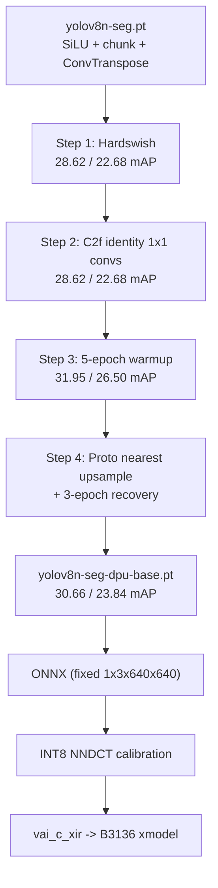

# End-to-End DPU Guide: YOLOv8-seg on Kria KV260

This guide documents the technical work required to take Ultralytics YOLOv8-seg from
PyTorch to a verified AMD/Xilinx `DPUCZDX8G` hardware binary on the Kria KV260.

- **Board target:** `DPUCZDX8G_ISA1_B3136`
- **Fingerprint:** `0x101000016010406`
- **Compiler:** Vitis AI 2.5
- **Runtime:** VART / XIR 2.5.0 (`xilinx/smartcam:2022.1`)

For setup, quick-start commands, and repository layout, see [README.md](README.md).

---

## 1. Why the stock model does not compile

The DPU is an INT8 systolic engine. It accelerates convolution, pooling, resize, and a
small set of activations, but it is not a general-purpose NPU.

| Constraint | Consequence for YOLOv8-seg |
| :--- | :--- |
| No exponential/sigmoid ALU | `nn.SiLU` falls back to the Arm CPU |
| No dynamic slicing | `torch.chunk` in `C2f` creates graph breaks |
| No transposed convolution | `nn.ConvTranspose2d` in `Proto` cannot be compiled |
| INT8 arithmetic | FP32 weights and activations require calibration |

Each fallback moves part of the graph to the Cortex-A53, destroying latency. The goal
was a graph with zero CPU subgraphs between input and the raw detection heads.

---

## 2. Architecture transformations



### Step 1: `SiLU` -> `Hardswish`

- **File:** `ultralytics/nn/modules/conv.py`
- `default_act` is `nn.Hardswish(inplace=True)` for `Conv`, `ConvTranspose`, and
  `RepConv`.
- Hardswish is piecewise linear (`x * ReLU6(x + 3) / 6`) and is fused into the
  preceding convolution by the DPU compiler.
- Zero-shot effect: box mAP50-95 36.19% -> 28.62%; mask mAP50-95 30.24% -> 22.68%.

### Step 2: `torch.chunk` -> frozen 1x1 identity convolutions

- **File:** `ultralytics/nn/modules/block.py`, class `C2f`
- `torch.chunk(feat, 2, dim=1)` is replaced with `split0(feat)` and `split1(feat)`.
- Both are 1x1 convolutions initialized to identity slices and frozen:
  `split0.weight[i, i] = 1`, `split1.weight[i, c + i] = 1`.
- The weights are frozen during training, so they remain exact identity operations.
- **File:** `ultralytics/engine/trainer.py` — `.split0` and `.split1` are added to
  `always_freeze_names`.
- Numerically identical to Step 1 (0.000% mAP difference); slicing becomes a normal
  convolution that the DPU compiles natively.

### Step 3: warmup fine-tuning

- 5 epochs on COCO with `lr0=0.001`, starting from the Hardswish + identity-split
  checkpoint.
- Result: box mAP50-95 31.95%, mask mAP50-95 26.50%.

### Step 4: `Proto` deconvolution -> nearest upsample

- **File:** `ultralytics/nn/modules/block.py`, class `Proto`
- `nn.ConvTranspose2d(c_, c_, 2, 2)` is replaced with
  `nn.Upsample(scale_factor=2, mode="nearest")`.
- The deconvolution removed 65,536 learned parameters, so a short recovery run was
  required.
- 3 recovery epochs produce **`yolov8n-seg-dpu-base.pt`**: box 30.66%, mask 23.84%
  mAP50-95.

---

## 3. Validation matrix

COCO `val2017`, 5,000 images, 640x640:

| Milestone | Checkpoint | Box mAP50-95 | Box mAP50 | Mask mAP50-95 | Mask mAP50 | Graph status |
| :--- | :--- | :---: | :---: | :---: | :---: | :--- |
| Official base | `yolov8n-seg.pt` | 36.19% | 51.56% | 30.24% | 48.84% | Incompatible |
| Hardswish | `yolov8n-seg-hardswish-init.pt` | 28.62% | 42.80% | 22.68% | 39.92% | Activation ready |
| C2f split | `yolov8n-seg-hardswish-c2fsplit.pt` | 28.62% | 42.80% | 22.68% | 39.92% | Split ready |
| Warmup | `yolov8n-seg-hardswish-c2fsplit-finetuned.pt` | 31.95% | 46.75% | 26.50% | 43.97% | Deconv left |
| **DPU base** | `yolov8n-seg-dpu-base.pt` | **30.66%** | **45.64%** | **23.84%** | **41.64%** | **Full DPU** |
| INT8 | `yolov8n-seg-dpu-base-int8.onnx` | 27.61% | 43.35% | 23.10% | 40.34% | Full DPU |

INT8 retention: **96.9%** mask mAP50, **96.9%** mask mAP50-95, **95.0%** box mAP50,
**90.1%** box mAP50-95.

---

## 4. ONNX export and graph inventory

```bash
python -c "
from ultralytics import YOLO
YOLO('checkpoints/yolov8n-seg-dpu-base.pt').export(
    format='onnx', imgsz=640, dynamic=False, simplify=True
)"
```

- Input: `(1, 3, 640, 640)`
- Outputs: `output0 (1, 116, 8400)` boxes/classes, `output1 (1, 32, 160, 160)` prototypes

| Operator | Count | DPU status |
| :--- | :---: | :--- |
| Conv | 92 | Compiled |
| HardSwish | 66 | Fused into convolutions |
| Resize (nearest) | 3 | Compiled |
| Concat / Add | 27 | Compiled |
| SiLU | 0 | Eliminated |
| ConvTranspose | 0 | Eliminated |
| Split / Slice | 0 | Eliminated |

For the hardware graph the detection head is truncated. `quantize_pytorch.py`
monkey-patches `Segment.forward` to return the 10 raw convolution tensors directly:
three scales x (box, class, mask coefficients), plus the prototype tensor. This avoids
anchor generation, DFL decoding, and `strided_slice` nodes in the DPU graph.

---

## 5. INT8 quantization

Calibration uses 50 COCO `val2017` images with letterbox preprocessing matching
deployment. `pytorch_nndct` analyzes the graph, equalizes weights, and exports the XIR
graph:

```
checkpoints/quantize_result/
├── SegmentationModel_int.xmodel
├── quant_info.json
├── bias_corr.pth
└── SegmentationModel.py
```

Run inside the Vitis AI 2.5 container:

```bash
docker run --rm -it -v "$PWD":/workspace \
  xilinx/vitis-ai-pytorch-cpu:2.5.0 \
  bash -lc "source /opt/vitis_ai/conda/bin/activate vitis-ai-pytorch && \
    python /workspace/dpu_workflow/quantize_pytorch.py"
```

Edit the hard-coded `/workspace/...` paths in the script for your layout.

An alternative ONNX Runtime QDQ quantization path is available in
`dpu_workflow/quantize_onnx.py`; the verified B3136 binary was produced through the
NNDCT path above.

---

## 6. Compilation

Compile against the **B3136** architecture file:

```bash
docker run --rm -it -v "$PWD":/workspace \
  xilinx/vitis-ai-pytorch-cpu:2.5.0 \
  bash -lc "source /opt/vitis_ai/conda/bin/activate vitis-ai-pytorch && \
    vai_c_xir \
      -x /workspace/checkpoints/quantize_result/SegmentationModel_int.xmodel \
      -a /workspace/dpu_workflow/arch_kv260_isa1_b3136.json \
      -o /workspace/checkpoints/compiled_kv260_b3136 \
      -n yolov8n_seg_kv260_b3136"
```

Outputs:

- `yolov8n_seg_kv260_b3136.xmodel` (6,370,506 bytes,
  MD5 `b29b1b05c03571d5860d8887f4a26c8e`)
- `meta.json` with `"target": "DPUCZDX8G_ISA1_B3136"`
- `md5sum.txt`

> The common `arch.json` shipped for KV260 targets `DPUCZDX8G_ISA1_B4096`. That binary
> does not match this board's fingerprint and will not run on the smartcam overlay used
> here.

---

## 7. Board deployment (Ubuntu 22.04)

### 7.1 Provisioning

```bash
sudo add-apt-repository -y ppa:xilinx-apps
sudo apt update
sudo apt install -y xlnx-firmware-kv260-smartcam \
                    vitis-ai-library vitis-ai-runtime \
                    python3-opencv python3-numpy
```

### 7.2 Load the accelerator

```bash
sudo xmutil unloadapp 0
sudo xmutil loadapp kv260-smartcam
xbutil examine
```

Expected: `[0000:00:00.0] : edge ... user(inst=0) Yes` and an active
`/dev/dri/renderD128`.

Reboot if the DPU was left in a bad state by an earlier failed model:

```bash
sudo reboot
sudo xmutil unloadapp 0
sudo xmutil loadapp kv260-smartcam
```

### 7.3 Run inference in the AMD container

Native Ubuntu 22.04 packages segfault because Canonical's Xilinx packages were built
with GCC 9 and conflict with the system libstdc++:

```text
#0 std::_Rb_tree_decrement(...) from libstdc++.so.6
#1 xir::XrtDeviceHandle::registar(...) from libvart-xrt-device-handle.so.2
#9 _dl_open("libvart-dpu-runner.so")
```

Use the official container to get a matching ABI:

```bash
cd ~/deploy_kv260   # contains run scripts and the .xmodel

docker run --rm -it --privileged \
  -v /dev:/dev -v /sys:/sys \
  -v /lib/firmware/xilinx:/lib/firmware/xilinx \
  -v "$PWD":/workspace -w /workspace \
  -e PYTHONPATH=/workspace/python_libs \
  xilinx/smartcam:2022.1 bash
```

Inside the container:

```bash
python3 run_kv260_dpu.py yolov8n_seg_kv260_b3136.xmodel test.jpg
python3 postprocess_b3136.py yolov8n_seg_kv260_b3136.xmodel test.jpg result.jpg
```

Expected tensor layout:

```text
input   [1, 640, 640, 3] xint8, fix_point 6
output  proto        [1, 160, 160, 32]
output  box/cls/mask 80x80, 40x40, 20x20
```

Measured on hardware (30 warmup + 300 iterations, p50): **B3136 42.16 ms (23.7 FPS)**.
The earlier 79.62 ms figure was a cold single-shot run. B4096 was also verified on the
benchmark overlay at **27.55 ms p50 (36.3 FPS)**, a 1.53x speedup. Post-processing
produced `bus 0.88`, `person 0.82`, `person 0.78`, `person 0.68` on the reference image
for both overlays. See [PERFORMANCE_AND_B4096.md](PERFORMANCE_AND_B4096.md).

---

## 8. ISA0 vs ISA1

| | `DPUCZDX8G_ISA0` | `DPUCZDX8G_ISA1` |
| :--- | :--- | :--- |
| Fingerprint | `0x1000020f6014407` | `0x101000016010406` (B3136) |
| Vitis AI | 2.0 / 2022.1 | 2.5 / 2022.2 |
| ALU engine | No | Yes |
| Activations | ReLU, LeakyReLU | ReLU, LeakyReLU, Hardswish |

The smartcam overlay used here exposes ISA1, which is why Hardswish runs entirely on
the DPU. ISA0 targets cannot compile this model and are not supported in this repo.

---

## 9. Retargeting to a custom dataset

1. Fine-tune `checkpoints/yolov8n-seg-dpu-base.pt` on your dataset with `train.py`.
2. Export the best checkpoint to fixed-shape ONNX.
3. Run `quantize_pytorch.py` with `--weights`, `--calib-dir`, and `--output-dir` in the
   cached Vitis AI 3.5 NNDCT image.
4. Compile with the same `arch_kv260_isa1_b3136.json` using `vai_c_xir` from the
   cached Vitis AI 2.5 image.
5. Copy the new `.xmodel` to the board and run `postprocess_b3136.py` or the C++
   runner `run_kv260_dpu`.

The architecture substitutions survive fine-tuning, so the resulting model remains
DPU-compatible without redoing the graph surgery.

The same recipe has been applied to defect detection. The 1-class crack model (`crack-best.pt`,
`crack-01-rshs1` v17) scores box 74.13% / mask 62.45% mAP50 on its held-out test split, and the
2-class crack + spalling model (`concrete-2cls`, 414-image test split) scores box 86.29% /
mask 79.88% mAP50; see the accuracy tables in [README.md](README.md#accuracy). Both keep the
graph shape described in §4 (Hardswish, frozen C2f split, nearest-upsample `Proto`). The
2-class checkpoint has now been quantized with the Vitis AI 3.5 NNDCT and compiled with
the 2.5 `vai_c_xir`; see `checkpoints/quantize_result_concrete_2cls/` and
`checkpoints/compiled_kv260_b3136_concrete_2cls/` (MD5 `29326065c560dc51a1a45883390209ce`)
or `checkpoints/compiled_kv260_b4096_concrete_2cls/` (MD5 `583a2e90fe93b82dbd4fe89a79d9f0a5`).
The 1-class crack model has not been quantized yet, so the COCO INT8 figures above are
still the only measured FP32 → INT8 retention for that checkpoint.
