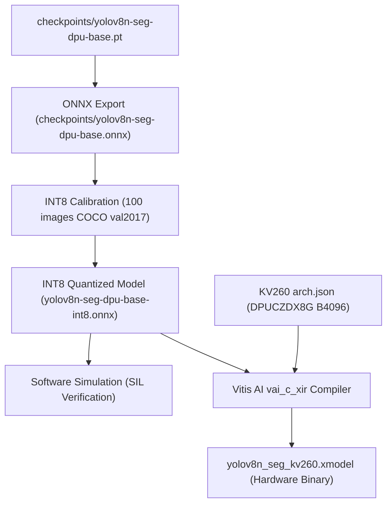

# YOLOv8-Seg DPU Adaptation Documentation

This document records the exact architectural modifications, operator compliance benchmarks, quantization workflow, and FPGA DPU compilation steps applied to **Ultralytics YOLOv8-seg** to make it 100% hardware-compatible with AMD/Xilinx DPU (`DPUCZDX8G` on Kria KV260).

---

## 1. Architectural Hardware Incompatibilities & Solutions

| Layer / Component                | Original YOLOv8-seg             | DPU Issue on KV260                                                     | Modification Applied                                                      |       DPU Status        |
| :------------------------------- | :------------------------------ | :--------------------------------------------------------------------- | :------------------------------------------------------------------------ | :---------------------: |
| **Activation Functions**         | `nn.SiLU()`                     | Unsupported by DPUCZDX8G ALU; falls back to Arm CPU                    | Replaced with `nn.Hardswish(inplace=True)`                                | ✅ 100% Fused into Conv |
| **Feature Splitting**            | `torch.chunk` in `C2f`          | Produces dynamic `Slice`/`Split` nodes that break DPU graph continuity | Replaced with two frozen $1 \times 1$ identity convs (`split0`, `split1`) |   ✅ 100% Native Conv   |
| **Segmentation Mask Upsampling** | `nn.ConvTranspose2d` in `Proto` | Unsupported deconvolution; forces graph break and CPU copy             | Replaced with `nn.Upsample(scale_factor=2, mode="nearest")`               |  ✅ 100% Native Resize  |

---

## 2. Checkpoint Evolution & COCO `val2017` Validation Matrix

Evaluated on 5,000 images from COCO `val2017` at 640×640:

| Milestone                    | Checkpoint (.pt)                              | Box mAP50-95 | Box mAP50  | Mask mAP50-95 | Mask mAP50 |      DPU Compatibility      |
| :--------------------------- | :-------------------------------------------- | :----------: | :--------: | :-----------: | :--------: | :-------------------------: |
| **0. Official Baseline**     | `yolov8n-seg.pt`                              |  **36.19%**  | **51.56%** |  **30.24%**   | **48.84%** |       ❌ Incompatible       |
| **1. Hardswish Zero-Shot**   | `yolov8n-seg-hardswish-init.pt`               |  **28.62%**  | **42.80%** |  **22.68%**   | **39.92%** |     ⚠️ Activation ready     |
| **2. C2f 1x1 Identity Conv** | `yolov8n-seg-hardswish-c2fsplit.pt`           |  **28.62%**  | **42.80%** |  **22.68%**   | **39.92%** |   ⚠️ C2f + Act DPU-native   |
| **3. C2f Warmup (5 epochs)** | `yolov8n-seg-hardswish-c2fsplit-finetuned.pt` |  **31.95%**  | **46.75%** |  **26.50%**   | **43.97%** |   ⚠️ `ConvTranspose` left   |
| **4. DPU Graph Complete**    | `yolov8n-seg-dpu-base.pt`                     |  **30.66%**  | **45.64%** |  **23.84%**   | **41.64%** | ✅ **100% DPU Graph Ready** |

---

## 3. ONNX Graph Verification

Exported Model: `checkpoints/yolov8n-seg-dpu-base.onnx`

- **Input**: `(1, 3, 640, 640)` BCHW
- **Outputs**:
  - Boxes & Classes: `(1, 116, 8400)`
  - Mask Prototypes: `(1, 32, 160, 160)`
- **Operator Inventory**:
  - `SiLU`: **0**
  - `ConvTranspose`: **0**
  - `Split` / `Chunk`: **0**
  - `Conv`: 92 (including $1 \times 1$ split identity convolutions)
  - `HardSwish`: 66
  - `Resize` (Nearest): 3

---

## 4. Quantization & Compilation Workflow (Phase 2)

1. **Quantization & Software-in-the-Loop (SIL)**:
   - Quantized to INT8 using calibration dataset reader.
   - Runs simulated INT8 inference to evaluate numerical stability and quantization loss.

### INT8 Quantization Validation Benchmark (500 COCO Images):

| Metric            | FP32 Base Model (`.pt`) | INT8 Quantized Model (`-int8.onnx`) | Retention Rate | Absolute Difference |
| :---------------- | :---------------------: | :---------------------------------: | :------------: | :-----------------: |
| **Mask mAP50**    |       **41.64%**        |             **40.34%**              |   **96.9%**    |      $-1.30\%$      |
| **Mask mAP50-95** |       **23.84%**        |             **23.10%**              |   **96.9%**    |      $-0.74\%$      |
| **Box mAP50**     |       **45.64%**        |             **43.35%**              |   **95.0%**    |      $-2.29\%$      |
| **Box mAP50-95**  |       **30.66%**        |             **27.61%**              |   **90.1%**    |      $-3.05\%$      |

2. **Vitis AI Compilation (`vai_c_xir`)**:
   - Compiles INT8 representation against `DPUCZDX8G` instruction set architecture.
   - Outputs compiled `.xmodel` (`checkpoints/compiled_kv260/yolov8n_seg_kv260.xmodel`, 5.2 MB) ready for deployment with VART on Kria KV260.
