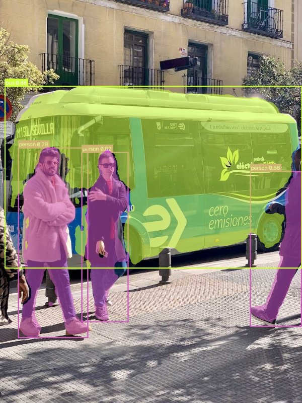

# YOLOv8-Seg on AMD Kria KV260 (DPUCZDX8G)

A DPU-aware fork of Ultralytics YOLOv8-seg, modified so the full network compiles to an
AMD/Xilinx `DPUCZDX8G` hardware binary (`.xmodel`) and runs on the Kria KV260.

**Verified on hardware:** the model below ran on a KV260 with the `kv260-smartcam`
overlay at **79.62 ms per inference (~12.6 FPS)**.



```
bus      0.88
person   0.82
person   0.78
person   0.68
```

---

## Verified target

| Item | Value |
| :--- | :--- |
| Board | AMD Kria KV260 Vision AI Starter Kit |
| DPU IP | `DPUCZDX8G_ISA1_B3136` |
| DPU fingerprint | `0x101000016010406` |
| Runtime | Vitis AI / VART / XIR **2.5.0** (`xilinx/smartcam:2022.1`) |
| Compiler target | `dpu_workflow/arch_kv260_isa1_b3136.json` |
| Model input | `[1, 640, 640, 3]` xint8 |
| Model outputs | 10 raw convolution tensors (box, class, mask coefficients, proto) |
| Measured latency | **79.62 ms (~12.6 FPS)** |
| Xmodel | `checkpoints/compiled_kv260_b3136/yolov8n_seg_kv260_b3136.xmodel` |
| Xmodel MD5 | `b29b1b05c03571d5860d8887f4a26c8e` |

> Use **B3136**, not the common KV260 default **B4096**. The smartcam bitstream on this
> board exposes `DPUCZDX8G_ISA1_B3136` with fingerprint `0x101000016010406`.

---

## Accuracy

COCO `val2017` (5,000 images, 640x640):

| Model stage | File | Box mAP50-95 | Box mAP50 | Mask mAP50-95 | Mask mAP50 |
| :--- | :--- | :---: | :---: | :---: | :---: |
| Official baseline | `yolov8n-seg.pt` | 36.19% | 51.56% | 30.24% | 48.84% |
| + Hardswish | `yolov8n-seg-hardswish-init.pt` | 28.62% | 42.80% | 22.68% | 39.92% |
| + C2f identity split | `yolov8n-seg-hardswish-c2fsplit.pt` | 28.62% | 42.80% | 22.68% | 39.92% |
| + warmup fine-tune | `yolov8n-seg-hardswish-c2fsplit-finetuned.pt` | 31.95% | 46.75% | 26.50% | 43.97% |
| **DPU base (FP32)** | `yolov8n-seg-dpu-base.pt` | **30.66%** | **45.64%** | **23.84%** | **41.64%** |
| **INT8 quantized** | `yolov8n-seg-dpu-base-int8.onnx` | **27.61%** | **43.35%** | **23.10%** | **40.34%** |

The INT8 model retains **96.9%** of the FP32 mask mAP and **90.1%** of the box mAP.
Per-run metrics are stored in `metrics/`.

> `.pt` and `.onnx` files are gitignored. Download or regenerate them before training,
> quantization, or compilation.

---

## DPU compatibility changes

All three changes are already applied in this repository:

| Original | Problem on DPUCZDX8G | Replacement |
| :--- | :--- | :--- |
| `nn.SiLU` | No exponential ALU; CPU fallback | `nn.Hardswish` in `ultralytics/nn/modules/conv.py` |
| `torch.chunk` in `C2f` | Dynamic slice/split breaks the DPU graph | Two frozen 1x1 identity convs (`split0`, `split1`) in `ultralytics/nn/modules/block.py` |
| `nn.ConvTranspose2d` in `Proto` | Transposed convolution unsupported | `nn.Upsample(scale_factor=2, mode="nearest")` in `ultralytics/nn/modules/block.py` |

The frozen split layers are registered in `always_freeze_names` inside
`ultralytics/engine/trainer.py` so fine-tuning cannot unfreeze them.

Resulting ONNX operator inventory: `Conv` 92, `HardSwish` 66, `Resize` 3,
`SiLU` 0, `ConvTranspose` 0, `Split/Slice` 0.

### Extending to YOLO11 / YOLO26

The vendored `ultralytics` package keeps all model families, including YOLO11 and
YOLO26. To target the DPU with those models, apply the same three substitutions to
their building blocks (notably the `C3k2` split path) and re-run the pipeline below.

---

## Repository layout

```
├── README.md
├── assets/                        # result images
├── DPU_END_TO_END_GUIDE.md        # detailed technical guide and root-cause notes
├── PERFORMANCE_AND_B4096.md       # ground-station split and B4096 targeting notes
├── train.py                       # fine-tuning entry point
├── validate.py                    # COCO mAP evaluation
├── coco_*.yaml                    # dataset configs (full / 500 / train)
├── ultralytics/                   # modified Ultralytics source (v8/v11/v26 models)
├── dpu_workflow/
│   ├── arch_kv260_isa1_b3136.json # compiler target for this board
│   ├── quantize_pytorch.py        # Vitis AI NNDCT INT8 quantization
│   ├── quantize_onnx.py           # optional ONNX Runtime INT8 path
│   ├── verify_simulation.py       # FP32 vs INT8 ONNX comparison
│   └── eval_int8_coco.py          # INT8 COCO evaluation
├── deploy_kv260/
│   ├── run_kv260_dpu.py           # VART runner (raw tensor output + timing)
│   └── postprocess_b3136.py       # DFL/NMS/mask decode -> annotated JPEG
├── checkpoints/
│   ├── compiled_kv260_b3136/      # verified hardware binary + meta.json
│   └── quantize_result/           # INT8 intermediate XIR graph
└── metrics/                       # JSON validation results
```

---

## Setup

```bash
python -m venv venv
# Windows: venv\Scripts\activate
source venv/bin/activate

pip install -e .
pip install onnx onnxruntime
```

Vitis AI compilation requires the AMD container (Vitis AI 2.5):

```bash
docker pull xilinx/vitis-ai-pytorch-cpu:2.5.0
```

---

## 1. Train / fine-tune

Start from the DPU-compatible base checkpoint so the architecture stays hardware-ready:

```bash
python train.py \
  --weights checkpoints/yolov8n-seg-dpu-base.pt \
  --data custom_data.yaml \
  --epochs 50 --batch 4 --imgsz 640
```

`train.py` defaults are tuned for a 4 GB GPU (batch 4). For large GPUs or Colab,
raise `--batch` to 16-32.

## 2. Validate

```bash
python validate.py --weights checkpoints/yolov8n-seg-dpu-base.pt --data coco_full_fast.yaml
python validate.py --weights checkpoints/yolov8n-seg-dpu-base-int8.onnx --data coco_full_fast.yaml
```

`coco_full_fast.yaml` validates all 5,000 `val2017` images while avoiding the
forced COCO RLE JSON step that makes segmentation validation very slow.

## 3. Export ONNX

```bash
python -c "
from ultralytics import YOLO
YOLO('checkpoints/yolov8n-seg-dpu-base.pt').export(
    format='onnx', imgsz=640, dynamic=False, simplify=True
)"
```

Expected outputs: `(1, 116, 8400)` boxes/classes and `(1, 32, 160, 160)` prototypes.

## 4. Quantize (INT8)

```bash
docker run --rm -it -v "$PWD":/workspace \
  xilinx/vitis-ai-pytorch-cpu:2.5.0 \
  bash -lc "source /opt/vitis_ai/conda/bin/activate vitis-ai-pytorch && \
    python /workspace/dpu_workflow/quantize_pytorch.py"
```

Adjust the hard-coded `/workspace` paths and calibration image directory at the top
of `dpu_workflow/quantize_pytorch.py`. The script truncates the detection head so it
emits the 10 raw convolution tensors, keeping the whole graph on the DPU.

## 5. Compile the xmodel

```bash
docker run --rm -it -v "$PWD":/workspace \
  xilinx/vitis-ai-pytorch-cpu:2.5.0 \
  bash -lc "source /opt/vitis_ai/conda/bin/activate vitis-ai-pytorch && \
    vai_c_xir \
      -x /workspace/checkpoints/quantize_result/SegmentationModel_int.xmodel \
      -a /workspace/dpu_workflow/arch_kv260_isa1_b3136.json \
      -o /workspace/checkpoints/compiled_kv260_b3136 \
      -n yolov8n_seg_kv260_b3136"
```

Verify `meta.json` reports `"target": "DPUCZDX8G_ISA1_B3136"` and compare
`md5sum.txt` with the generated binary.

---

## 6. Deploy on the KV260

```bash
# On the board: load the DPU overlay
sudo xmutil unloadapp 0
sudo xmutil loadapp kv260-smartcam
xbutil examine          # device should report Ready: Yes

# Copy deploy_kv260/ and the .xmodel to ~/deploy_kv260 on the board, then:
cd ~/deploy_kv260
docker run --rm -it --privileged \
  -v /dev:/dev -v /sys:/sys \
  -v /lib/firmware/xilinx:/lib/firmware/xilinx \
  -v "$PWD":/workspace -w /workspace \
  -e PYTHONPATH=/workspace/python_libs \
  xilinx/smartcam:2022.1 bash
```

Inside the container:

```bash
# Raw tensors + latency
python3 run_kv260_dpu.py yolov8n_seg_kv260_b3136.xmodel test.jpg

# Annotated segmentation result
python3 postprocess_b3136.py yolov8n_seg_kv260_b3136.xmodel test.jpg result.jpg
```

`postprocess_b3136.py` performs DFL box decoding, sigmoid scoring, class-aware NMS,
and `mask_coeff x proto` mask generation on the board, then writes an annotated JPEG.

---

## Optional: B4096 and ground-station post-processing

The KV260 can also load AMD's DPU-only **B4096 benchmark overlay**
(`xlnx-firmware-kv260-benchmark-b4096`), which raises peak throughput from
0.92 TOPS to 1.23 TOPS. If post-processing is moved to a ground station, the board
only needs to transmit the raw int8 tensors, making that DPU-only overlay a good fit.

See [PERFORMANCE_AND_B4096.md](PERFORMANCE_AND_B4096.md) for:

- raw-output bandwidth and packet format,
- B4096 resource, ISA, and fingerprint caveats,
- loading the B4096 overlay and compiling with
  `dpu_workflow/arch_kv260_isa1_b4096.json`,
- expected gains, benchmark method, and references.

The verified production path in this repository remains the B3136 smartcam overlay.

## Troubleshooting

- **First run hangs / times out:** the DPU/KDS can get stuck after a previous failed
  model. A clean reboot is the reliable fix; reloading the overlay alone may not be
  enough.
  ```bash
  sudo reboot
  # after boot
  sudo xmutil unloadapp 0
  sudo xmutil loadapp kv260-smartcam
  ```
- **Segfault in `std::_Rb_tree_decrement` on bare-metal Ubuntu 22.04:** native Xilinx
  packages were built with GCC 9 and conflict with Ubuntu 22.04's libstdc++. Run
  inference inside the `xilinx/smartcam:2022.1` container instead.
- **Compilation fails on Hardswish:** confirm the target is `DPUCZDX8G_ISA1_B3136`.
  ISA0 devices have no ALU engine and only support ReLU/LeakyReLU.
- **Accuracy drop after quantization:** rebuild the calibration set from images that
  match your deployment domain, and keep the letterbox preprocessing consistent.

See [DPU_END_TO_END_GUIDE.md](DPU_END_TO_END_GUIDE.md) for the full root-cause
analysis, per-stage benchmarks, and compiler details.

---

## License

The modified Ultralytics source is distributed under **AGPL-3.0**. See `LICENSE`.
